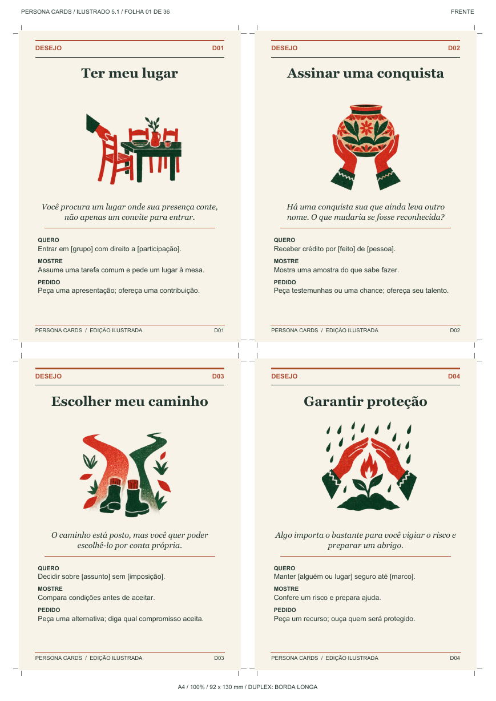
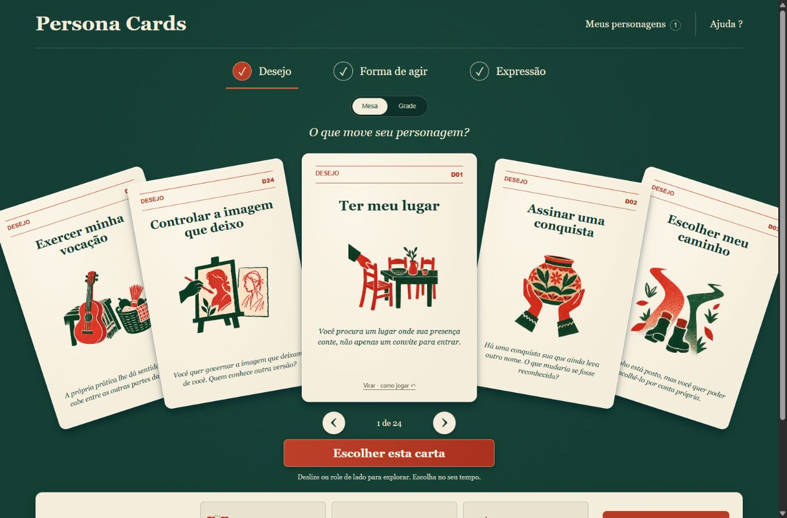
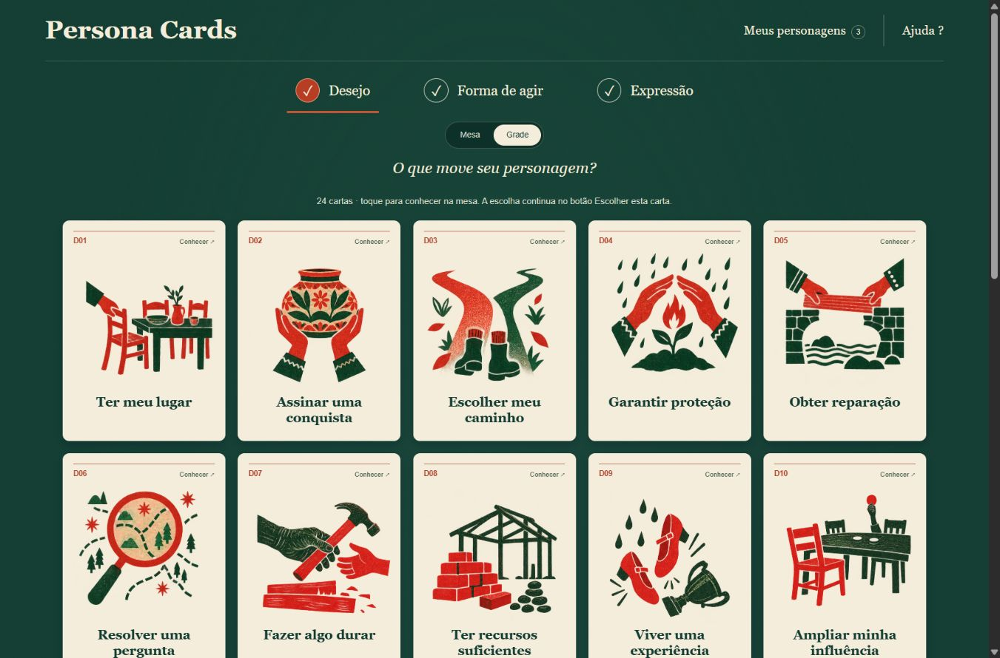

<div align="center">


# Persona Cards

### Draw three cards. Bring a character to life.

A Portuguese narrative card game for RPGs and fiction: **what characters want, how they act, and how they express themselves**.

[](deck/manual-5.1.md)
[](skills/persona-cards/print/README.md)

[Three ways to play](#three-ways-to-use-the-same-deck) · [How to play](#how-to-play) · [PDF](#1-pdf--cards-on-your-table) · [Skill](#2-skill--cards-with-your-assistant) · [Web](#3-web-application--cards-in-your-browser) · [Five examples](#five-characters-built-with-the-cards) · [Português](README.md)

</div>

## Three ways to use the same deck

| I want to… | Open | What it does |
| --- | --- | --- |
| **Play with physical cards** | [Printable PDF](skills/persona-cards/print/Persona-Cards-5.1-Ilustrado-Duplex-A4.pdf) | Print, sort the families, and choose or draw. No computer or AI needed. |
| **Create with an AI assistant** | [Persona Cards skill](skills/persona-cards/) | A folder containing the deck and instructions for a compatible assistant. |
| **Explore the cards on screen** | [Web application](app/) | Browse, choose, save, and export character combinations in your browser. |

These are three ways to access the same game; use whichever suits your table. Persona Cards supports invention and interpretation. Your RPG system supplies combat rules, statistics, and dice resolution. The card text is in Portuguese.

## How to play

**[Download edition 5.1](https://github.com/eep0x10/persona-cards/releases/tag/v5.1.0):** individual PDFs and a project ZIP containing the skill, the built web application, instructions and documentation.

Sort the cards by the letters in their headers. Choose or draw **one D, one F, and one V**, then read each opening prompt.

| Card | Question | Example |
| --- | --- | --- |
| **D · Desire** | What do they want now? | Reopen a crossing for an isolated neighborhood. |
| **F · Way of acting** | How do they try? | Bring residents and the council into a negotiation. |
| **V · Expression** | How does it appear in speech or gesture? | Explain one step at a time and draw the route. |

Add a name, role, competence, and everyday habit or pleasure. Attempt something in a scene. Other people may accept, negotiate, or refuse; the cards do not choose the outcome.

**Quick example:** Lina is a boat operator. **D12 — Abrir um horizonte** becomes opening a route; **F07 — Aproximo as partes** becomes a meeting between residents and the council; **V11 — Passo a passo** becomes “First we measure the depth. Then we mark the return route.” Three cards already give her something to do.

Add **L (Relationship)** for someone with their own goals and **P (Pressure)** for a circumstance that changes the decision. Use **N (Internal conflict)** only when two values the character genuinely wants to preserve compete. **U/G** are reference guides, excluded from personality draws. There are **126 creation cards and 15 guides**, 141 in all. Choose cards deliberately or draw for surprise. Preserve established story events when a card no longer fits. Trauma, secrets, and redemption are optional.

## 1. PDF — cards on your table

Each 5.1 card has an individual reading prompt and folk illustration. This is an actual print sheet:



- **[Complete front/back PDF](skills/persona-cards/print/Persona-Cards-5.1-Ilustrado-Duplex-A4.pdf):** automatic duplex printing.
- [Fronts](skills/persona-cards/print/Persona-Cards-5.1-Ilustrado-Frentes-A4.pdf) + [backs](skills/persona-cards/print/Persona-Cards-5.1-Ilustrado-Versos-A4.pdf): printing each side separately.
- [Quick printing manual](skills/persona-cards/print/Persona-Cards-5.1-Ilustrado-Manual-Rapido.pdf): keep the instructions with your deck.

Choose **A4 portrait, actual size / 100%, flip on the long edge**. Test two consecutive pages of the complete PDF before printing the rest, then cut along the marks. Cards measure **92 × 130 mm**, four per sheet, on 36 sheets; the last has one card. Manual paper reinsertion depends on the printer. You can also read the PDF on screen and record the codes. Digital layout checks passed; a physical print test has not been performed. [5.0 archive](skills/persona-cards/print/README.md#edição-original-50).

## 2. Skill — cards with your assistant

A **skill** is a folder of instructions and references that a compatible assistant can consult. It contains the same deck and method, rather than a separate character system.

**In Codex:** download this repository through **Code → Download ZIP**, extract it, and copy the entire `skills/persona-cards` folder to your skill directory. The usual Windows destination is `C:\Users\YOUR_USER\.codex\skills\persona-cards`; on macOS/Linux, `~/.codex/skills/persona-cards`. Start a new conversation that recognizes the skill. `SKILL.md` should be directly inside that folder.

```text
Use $persona-cards to create a fantasy RPG ally.
She operates a boat and wants to reopen a crossing.
Choose the cards, explain the combination, and write an encounter scene.
```

Give your assistant the setting and established facts. Ask for a quick NPC, villain, cast, or deeper interpretation. The assistant consults the cards and proposes actions and choices; you decide what becomes part of the campaign.

Without skill support, attach or paste [`docs/persona-cards-gpt.md`](docs/persona-cards-gpt.md), which combines instructions and deck, into the same conversation as your request. This does not install it in other chats.

## 3. Web application — cards in your browser

The application lets you explore the deck, assemble combinations, and save and export characters. Data stays in that browser rather than an account or remote character database.

**A card table, without forms.** Switch between **Mesa** (a fan of cards) and **Grade** (a grid for comparing one family). These are screenshots of the application.



<details>
<summary>See the grid view</summary>



</details>

1. Start with **Desejo**. Browse with arrows, swipe on a phone or scroll horizontally over the hand. In **Grade**, tap a card to inspect it on the table.
2. Use **Virar · como jogar** to read its instructions. Browsing and flipping do not select it.
3. Press **Escolher esta carta**. It joins your combination and the table guides you through **D → F → V**. Tap a combination slot to revisit it.
4. **Salvar combinação** saves it with an automatic name. **Meus personagens** lets you reopen, duplicate and delete saved combinations.
5. **Aprofundar · guias** opens optional L/P/N and U/G guides. **Sortear · manter** draws cards while keeping locked choices. **Importar · exportar** transfers JSON or Markdown copies.

**Anime.js** animates browsing, flipping and placing cards. Motion follows your system preference; the footer lets you choose full or reduced motion and return to **Seguir sistema**. Text from older characters remains preserved and included in exports, without editing fields on the table.

On Windows, install **Git, Python 3.12+, and Node.js 22 with npm**, open PowerShell, and run:

```powershell
git clone https://github.com/eep0x10/persona-cards.git
cd persona-cards/app
./iniciar.ps1
```

Open **http://127.0.0.1:8766**. The launcher prepares dependencies on the first run. For later sessions, run `./iniciar.ps1` from `app` again.

<details>
<summary>If PowerShell blocks the script, or you updated the project</summary>

You can start manually without changing PowerShell policy. From `app`:

```powershell
python -m venv .venv
.\.venv\Scripts\python.exe -m pip install -r requirements.lock.txt
npm ci
npm run build
.\.venv\Scripts\python.exe -m uvicorn server:app --host 127.0.0.1 --port 8766
```

Open the same address and keep the terminal running. If the port is occupied, try opening the existing application first. After downloading an update, run `npm ci` and `npm run build` again, restart the process you opened, and reload the page. The launcher reuses a healthy service and does not rebuild an existing interface. If `python`, `git`, or `npm` is not recognized, finish installing it and open a new terminal.

</details>

<details>
<summary>Linux and macOS</summary>

With Git, Python 3.12+, and Node.js 22 installed:

```sh
git clone https://github.com/eep0x10/persona-cards.git
cd persona-cards/app
python3 -m venv .venv
.venv/bin/python -m pip install -r requirements.lock.txt
npm ci
npm run build
.venv/bin/python -m uvicorn server:app --host 127.0.0.1 --port 8766
```

Open **http://127.0.0.1:8766** and keep the process running while using the app.

</details>

**Keep a copy:** storage belongs to that browser, address, and port. Export to transfer a character or back it up. Clearing site data may erase local characters. No AI key is required; installation downloads dependencies.

## Five characters built with the cards

These are real card codes. The first three are interpretations of familiar characters in **invented, non-canon scenes**. The final two are original characters in the same campaign. They illustrate the game and are not observed table playtests.

### 1. Luffy — One Piece

**D03 — Escolher meu caminho · F17 — Tomo a frente · V09 — Entusiasmo que convida**

His [official profile](https://one-piece.com/character/luffy/index.html) establishes the Pirate King ambition, adventure, and companions. Here D03 expresses freedom to choose the route, F17 starts the action, and V09 invites others into the adventure. **L08/P04** adds a crewmate who needs a different stop. In our hypothetical scene he points to an island, but must listen, negotiate, or insist when the other person refuses. No N is necessary: risk and fatigue alone do not establish two competing internal values.

### 2. Zuko — Avatar: The Last Airbender

**D15 — Entender quem sou · F15 — Insisto além do custo · V04 — Conclusão primeiro**

This reading follows a period of change, drawing on his [official profile](https://www.avatarstudiosofficial.com/characters/). D15 questions who he wants to become; F15 makes persistence cost him something; V04 gives him a decision before the explanation. **L07** places Iroh in an advisory role. **N03/P05** pits truth against belonging after reliable evidence challenges an order. In the invented scene Zuko refuses part of the order and shows the evidence. Advice does not settle the decision, and a truthful choice does not guarantee reconciliation.

### 3. Batman — DC Comics

**D04 — Garantir proteção · F01 — Planejo antes · V04 — Conclusão primeiro**

The [official DC profile](https://www.dc.com/characters/batman) supports a protector, investigator, and strategist. D04 becomes keeping residents safe; F01 organizes investigation and rescue; V04 delivers a brief direction. **L07/P03** introduces Alfred's advice and a protocol that has closed the intended shelter. Our invented scene asks Batman to find an alternative, challenge the rule, or offer resources. Residents and staff can still disagree. A vow or dual identity does not automatically require N. Zuko and Batman share V04 but interpret it differently.

### A campaign: the gates of Porto da Névoa

Low water reveals an old channel. Isolated neighborhoods need the crossing; the council proposes closing it after accidents. An old map shows a possible route, but current safety still needs to be tested.

### 4. Ally: Lina Moura, boat operator and mapmaker

**D12 — Abrir um horizonte · F07 — Aproximo as partes · V11 — Passo a passo · L03 — Sócio de outra ideia · P12 — Duas promessas, um recurso**

Lina reads currents, draws waterproof maps, and repairs miniature boats for pleasure. Her cards turn reopening the crossing into negotiation and clear steps. Her co-owner Dara wants their boat kept available for evacuation (**L03**). Delivering medicine and inspecting the route require the same boat at dawn (**P12**). Lina asks the players for help and negotiates with Dara. Refusal makes her find another boat or renegotiate a promise. Players can help, question the map, or offer another solution. Being an ally does not make everyone obey her.

### 5. Villain: Seris Vale, councilor of the crossings

**D10 — Ampliar minha influência · F14 — Oculto e enceno · V16 — Encanto calculado · L15 — Aliança por interesse · P05 — Evidência inesperada**

Seris wants sole control of routes and tolls. A skilled stock administrator who prevented past shortages, she uses that credit to concentrate power. F14 conceals an old map while she claims no other passage ever existed; V16 makes the demand courteous. She restores book bindings outside council work. The warehouse guild cooperates while it profits (**L15**). A reliable record exposes her false claim (**P05**), but does not establish present safety. She can demand inspection, try to control it, or discredit Lina. Players can oppose the monopoly through evidence, negotiation, oversight, or combat. No N is established; being challenged does not create remorse automatically.

## After the scene

Record the attempt, the response, and what changed. Keep a card while it serves the character; replace it when established events require something else. Intentions, behavior, relationships, and consequences create depth without using every family.

<details>
<summary>Project files and maintenance</summary>

Use PDF, skill, or web. Other directories contain their production sources and checks: `skills/persona-cards/` is portable, `print/` contains PDFs and artwork, `app/` contains the web tool and local API, and `deck/`, `docs/`, and `tests/` support production and verification.

[Quick start and troubleshooting](docs/QUICKSTART.md) · [Privacy](docs/PRIVACY.md) · [Architecture](docs/ARCHITECTURE.md) · [API](docs/API.md) · [Testing](docs/TESTING.md) · [Contributing](CONTRIBUTING.md) · [History](CHANGELOG.md)

[](https://github.com/eep0x10/persona-cards/actions/workflows/checks.yml)

The 5.0 deck remains frozen; three active 5.1 JSON copies must match. Banner and illustrations were created with AI for this project. Initial conceptual inspiration: [Anatomia do personagem by Jurandir Gouveia](https://jurandirgouveia.com/anatomia-do-storytelling/anatomia-do-personagem/), with no affiliation or endorsement. Pop culture characters belong to their respective works. Project redistribution licensing has not been defined; dependencies retain their licenses.

</details>
