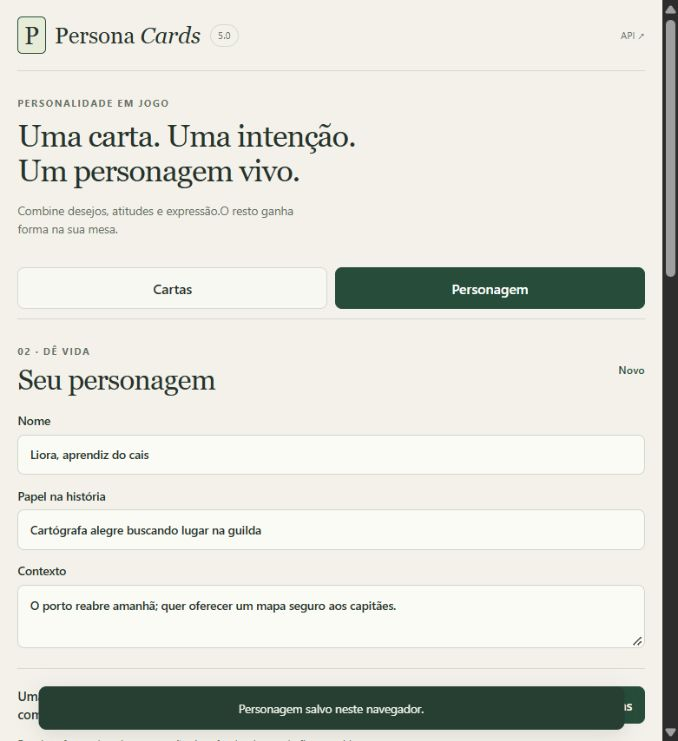

<div align="center">


# Persona Cards

### Living characters. Meaningful choices.

A Portuguese narrative deck, AI assistant skill and local character workshop. Turn goals, methods and expression into actions, relationships and choices at the table.

[](https://github.com/eep0x10/persona-cards/actions/workflows/checks.yml)
[](deck/manual-5.0.md)
[](docs/PRIVACY.md)

[Quick start](#quick-start) · [Method](#from-cards-to-a-scene) · [Documentation](#documentation) · [Downloads](https://github.com/eep0x10/persona-cards/releases/latest) · [Português](README.md)

</div>

> The banner is AI-generated brand artwork. Application screenshots use fictional test characters. The full deck and supporting guides are in Portuguese.

## Quick start

Requirements: Git, Python 3.12+ and Node.js 22 LTS with npm. CI uses Python 3.12 and Node 22.

Windows:

```powershell
git clone https://github.com/eep0x10/persona-cards.git
cd persona-cards/app
./iniciar.ps1
```

Open **http://127.0.0.1:8766**. No account or AI key is required. The Windows launcher prepares missing dependencies and runs the server in the background.

<details>
<summary>Linux/macOS or manual setup</summary>

```sh
git clone https://github.com/eep0x10/persona-cards.git
cd persona-cards/app
python3 -m venv .venv
.venv/bin/python -m pip install -r requirements.lock.txt
npm ci
npm run build
.venv/bin/python -m uvicorn server:app --host 127.0.0.1 --port 8766
```

</details>

Browse cards, inspect their fields, explicitly select them, draw combinations, lock cards and edit the character. Save locally and export JSON/Markdown. Importing a valid JSON creates another character without replacing the draft.



## From cards to a scene

Start with **D: goal**, **F: method** and **V: expression**. Add **L: relationship** and **P: pressure** when useful. **N: internal conflict** requires two real values in competition; a cost or external obstacle alone is insufficient. U/G are reference guides, excluded from personality draws.

Version 5.0 contains **126 creation cards and 15 guides**. Context, everyday habits, independent relationships and consequences bring the prompts to life. Preserve player agency and established campaign facts.

Install `skills/persona-cards/` in your assistant's skill directory (usually `~/.codex/skills/` for Codex), then invoke `$persona-cards` in a session that discovers it. Clients without skill support can receive the [self-contained instructions and deck](docs/persona-cards-gpt.md). Installation does not propagate automatically to other chats.

## Documentation

| Guide | Contents |
| :--- | :--- |
| [Quick start](docs/QUICKSTART.md) | Setup and first character |
| [Operations](docs/OPERATIONS.md) | Process, updates and backups |
| [Skill](docs/SKILL.md) | Installation and portable lookup |
| [Architecture](docs/ARCHITECTURE.md) | Client, API and deck copies |
| [API](docs/API.md) | Stateless endpoints and examples |
| [Privacy](docs/PRIVACY.md) | Browser storage and external dependencies |
| [Testing](docs/TESTING.md) | Contracts, evidence and limitations |
| [Brand](docs/BRAND.md) | Identity and documentation |
| [Contributing](CONTRIBUTING.md) | Review criteria |

## Validation and limits

```sh
python -m unittest discover -s tests
python -m pip install -r app/requirements.lock.txt
python -m unittest discover -s app -p test_api.py
npm --prefix app ci
npm --prefix app run build
```

Swagger is available at `/api/docs`, OpenAPI at `/api/openapi.json`. The local server binds to loopback. Character data stays in the browser, scoped to its origin; export JSON for backup. There are no accounts, remote character database, synchronization or connected AI generation.

Narrative evaluations are author exercises, not independent validation or table playtests. No universal quality, speed or mechanical balance is claimed. Printable PDFs include all 141 cards; see the [printing guide](skills/persona-cards/print/README.md). Redistribution licensing has not been defined; dependencies retain their own licenses.

Initial conceptual reference: [Anatomia do personagem — Jurandir Gouveia](https://jurandirgouveia.com/anatomia-do-storytelling/anatomia-do-personagem/). This project does not imply endorsement by that author.

## Printable cards

[Duplex A4](skills/persona-cards/print/Persona-Cards-5.0-Duplex-A4.pdf) · [Frentes / Fronts](skills/persona-cards/print/Persona-Cards-5.0-Frentes-A4.pdf) · [Versos / Backs](skills/persona-cards/print/Persona-Cards-5.0-Versos-A4.pdf) · [Manual](skills/persona-cards/print/Persona-Cards-5.0-Manual-Rapido.pdf)
