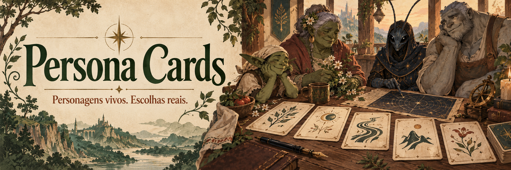
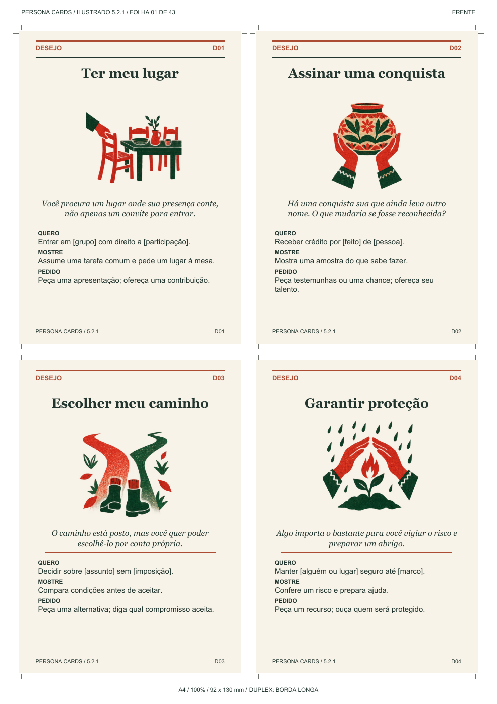

<div align="center">



# Persona Cards

### Eight cards. A story that keeps moving.

A Portuguese narrative deck for RPGs and fiction, connecting **past, conviction, intention and choices**.

[](deck/manual-5.2.md)
[](skills/persona-cards/print/README.md)

[How to play](#how-to-play) · [Call and destiny](#call-and-destiny) · [PDF](#1-pdf--cards-on-your-table) · [Skill](#2-skill--cards-with-your-assistant) · [Web](#3-web-application--cards-in-your-browser) · [Examples](#five-characters-built-with-the-cards) · [Português](README.md)

</div>

## Three ways to use the same deck

| I want… | Open | How it works |
| --- | --- | --- |
| **Physical cards** | [Printable PDF](skills/persona-cards/print/Persona-Cards-5.2-Ilustrado-Duplex-A4.pdf) | Choose or draw by family, without a computer or AI. |
| **An AI assistant** | [Persona Cards skill](skills/persona-cards/) | Instructions, deck and examples for a compatible assistant. |
| **Cards on screen** | [Online table](https://personcard.runictools.com/) | Explore, assemble and keep characters in your browser. |

Edition **5.2 / revision 5.2.1** has **153 creation cards and 16 guides**, 169 in total. Your RPG supplies combat, statistics and resolution rules. The card text is Portuguese.

Revision **5.2.1** adds F21 (teaching through attempts), F22 (listening before proposing) and N23 (immediate pleasure versus a longer project), with clarified card wording. See the [editorial review](docs/REVISAO-BARALHO-5.2.1.md).

## How to play

Sort families and choose or draw **one OR, CV, D, F, V, L, P and N**. All eight are required for a complete 5.2 character.

| Family | Question | Cards |
| --- | --- | ---: |
| OR · Origin | What happened before and still matters? | 12 |
| CV · Conviction | What belief, value or rule informs choices? | 12 |
| D · Desire | What do they want now? | 24 |
| F · Way of acting | How do they try? | 22 |
| V · Expression | How do speech, gesture, writing or signs convey intention? | 22 |
| L · Relationship | Who or what matters to their decisions? | 20 |
| P · Pressure | What circumstance changes the next choice? | 18 |
| N · Internal conflict | Which two genuinely valued sides compete? | 23 |

Connect OR and CV through **because of that**, **despite that**, or **later I learned**. Trauma, secrets and guilt are not required. Make D concrete, show F and V in an attempt, respect living people's agency in L, and describe the change in circumstances through P. Objects and dead people do not acquire a current will without an established setting rule. Add a name, role, competence and everyday pleasure.

**N is required, but adversity alone is not internal conflict.** Replace or redraw N if it only describes an obstacle or does not fit two genuine values. Do not force remorse, goodness or redemption. Preserve established facts; an existing character remains pending if a suitable proposal is still missing.

## Call and destiny

Consult **G07** for every creation. Choose or roll **1d6 independently in each column**.

| d6 | Call | Initial response |
| --- | --- | --- |
| 1 | Someone asks | Accept |
| 2 | Role or inheritance | Refuse |
| 3 | Concrete risk | Delay and investigate |
| 4 | Encounter or invitation | Negotiate conditions |
| 5 | Omen or prophecy | Try to prevent the future |
| 6 | Nature, time or finitude | Seek another way to fulfill it |

Record **call, response, fact, belief and choice**. Facts are confirmed circumstances; beliefs assign meaning; choices state what the person tries now. A prophecy may be an uncertain account. Refusal is not automatically cowardice, acceptance does not establish goodness, and a die does not choose the ending. Others can disagree.

U/G remain reference guides outside personality draws. G07 accompanies the eight cards rather than replacing one. After a scene, record attempts, responses and observed consequences, preserving established events.

## 1. PDF — cards on your table



- [Complete duplex deck](skills/persona-cards/print/Persona-Cards-5.2-Ilustrado-Duplex-A4.pdf).
- [Fronts](skills/persona-cards/print/Persona-Cards-5.2-Ilustrado-Frentes-A4.pdf) and [backs](skills/persona-cards/print/Persona-Cards-5.2-Ilustrado-Versos-A4.pdf).
- [Quick printing manual](skills/persona-cards/print/Persona-Cards-5.2-Ilustrado-Manual-Rapido.pdf).

Use **A4 portrait, actual size / 100%, flip on the long edge**. Test a consecutive front/back pair first. Cards measure **92 × 130 mm**, four per sheet: **43 sheets / 86 duplex pages**, with one card on the final sheet. Manual paper reinsertion depends on the printer. Digital checks do not replace a physical print test or table use. [Printing details and archives](skills/persona-cards/print/README.md).

## 2. Skill — cards with your assistant

A skill is a folder of instructions and references, rather than an account or image generator. Download through **Code → Download ZIP**, extract, and copy the whole `skills/persona-cards` folder into `~/.codex/skills/persona-cards`. The usual Windows path is `C:\Users\YOUR_USER\.codex\skills\persona-cards`. Start a conversation that recognizes it; `SKILL.md` belongs directly inside that directory.

```text
Use $persona-cards 5.2 to create a boat operator as an ally.
Choose and interpret OR/CV/D/F/V/L/P/N, with two genuine values in N.
Complete call, response, fact, belief and choice using G07.
Show an attempt in a scene and a possible response to refusal.
```

Supply the setting and established facts; you decide what enters the campaign. Without skill support, attach or paste [the self-contained instructions, cards and examples](docs/persona-cards-gpt.md) in the same conversation. This does not install the skill in other chats.

## 3. Web application — cards in your browser

**[Open the RunicTools table](https://personcard.runictools.com/)**. You can also play entirely with paper or the skill.

Explore all **eight families**, switch Mesa/Grade, flip to read, then select explicitly. Browsing does not change your choices. **Sortear · manter** preserves locked cards while drawing others; U/G stay in reference browsing.

**Salvar personagem** opens the review: name the character, interpret eight cards and complete the five Call and destiny fields. Forms belong to saving/reviewing; browsing the table uses cards. Photo, role, context and notes are optional. Finalization requires valid selections, interpretations and journey. Reopen, edit and export your character.

**Inspiration:** browse **105 complete 5.2 readings**, each with eight illustrated cards, an explanation for every choice and G07: call, response, fact, belief and room for choice. These are authored interpretations and proposed scenes, not canonical biographies. Copy a base to adapt it; replacing your current draft requires confirmation. **Legacy data:** 5.0/5.1 characters retain their text and open as pending drafts when layers are missing, without automatically inventing a past or internal conflict.

Data and photos stay in that browser and origin (protocol, host and port), without an account or remote character database. Export JSON for a full backup; clearing site data may erase local-only work. Markdown/PNG are reading formats; JSON supports transfer. Photos are processed locally. Anime.js supplies motion; the footer offers reduced motion and system preference.

New examples include **Edward Elric, Alphonse Elric, Frieren, Gon Freecss and Killua Zoldyck**. The [105-character review](docs/REVISAO-105-PERSONAGENS.md) records decisions for every family and G07, with reading scopes and source limits.

### Run locally

Install **Git, Python 3.12+ and Node.js 22 with npm**. In PowerShell:

```powershell
git clone https://github.com/eep0x10/persona-cards.git
cd persona-cards/app
./iniciar.ps1
```

Open **http://127.0.0.1:8766**. The launcher reuses a healthy service; see [quick start](docs/QUICKSTART.md) for blocked scripts, updates and manual Linux/macOS setup. Export your work before updating. Installation downloads dependencies; no AI key is needed.

## Five characters built with the cards

These use real codes. **All added origins, convictions, tensions and scenes are authorial proposals, not canon events or conclusions about the original characters.** The final two are original characters in one campaign. These are examples, not observed playtests.

### 1. Luffy — One Piece

**OR04 · CV05 · D03 · F17 · V09 · L08 · P04 · N07 · G07**

In our proposed scene, a companion stayed after a defeat (OR04). Luffy reads that support as room for choice, rather than ownership of another person's decisions (CV05). He wants to choose the next island (D03), starts the action (F17), and invites with enthusiasm (V09). Nami has independent priorities (L08); a crewmate chooses to stay at port (P04). We explicitly propose two valued sides: **freedom to leave and an accepted commitment to accompany the crewmate through a delivery** (N07).

**G07:** call — a companion asks for help; response — renegotiate; fact — the delivery remains unfinished; belief — freedom allows chosen commitments; choice — agree on a stop without deciding for Nami. She can refuse. Competence: leading in action; pleasure: looking for a meal on the next island.

### 2. Zuko — Avatar: The Last Airbender

**OR03 · CV07 · D15 · F15 · V04 · L07 · P05 · N03 · G07**

The proposed antecedent is preparation for an inherited role (OR03); the conviction values truth (CV07). Zuko questions who he chooses to be (D15), persists beyond visible cost (F15), and gives the conclusion first (V04). Iroh advises with his own criteria (L07). Reliable evidence contradicts an order (P05). **Truth and family/national belonging** both matter in this scene (N03); adversity alone would not establish that pair.

**G07:** call — an inherited obligation; response — renegotiate; fact — the document contradicts the justification; belief — disagreement need not erase every valued part of his origin; choice — refuse that part and show the evidence. Nobody's reconciliation is guaranteed. Competence: disciplined training; proposed pleasure: preparing a drink during a pause.

### 3. Batman — DC Comics

**OR01 · CV06 · D04 · F01 · V04 · L07 · P03 · N14 · G07**

An absence remains present in his routine (OR01); protecting a life matters beyond utility (CV06). He wants residents safe from an attack (D04), prepares resources (F01), and gives brief directions (V04). Alfred advises without controlling the decision (L07). A protocol has closed the shelter (P03). We propose **checking every detail and allowing capable allies genuine initiative** as competing values (N14), rather than deriving conflict from a vow or dual identity.

**G07:** call — a threat; response — redirect; fact — the shelter is closed; belief — protection cannot depend on one person's supervision alone; choice — entrust an alternative route to Alfred while investigating. Residents can disagree. Competence: investigation; proposed pleasure: restoring a small mechanism.

### A campaign: the gates of Porto da Névoa

Low water reveals an old channel. Residents need a crossing; the council wants it closed after accidents. An old map **does not establish present safety**.

### 4. Ally: Lina Moura, boat operator and mapmaker

**OR12 · CV03 · D12 · F07 · V11 · L03 · P12 · N02 · G07**

Mapping currents became a meaningful pleasure (OR12), and care means showing up (CV03). Lina wants a crossing reopened (D12), translates the parties' requests (F07), and explains practical steps (V11). Her partner Dara wants their boat available for evacuation (L03); inspection and a promised medicine delivery need it at dawn (P12). Lina values **efficient use of scarce resources and giving affected people a voice** (N02).

**G07:** call — residents' invitation; response — renegotiate; fact — one boat is available; belief — the route deserves testing, not advance certainty; choice — consult those affected and ask for help measuring. Dara and the players may refuse. Competence: reading currents; pleasure: repairing miniature boats.

### 5. Villain: Seris Vale, councilor of the crossings

**OR09 · CV01 · D10 · F14 · V16 · L15 · P05 · N14 · G07**

An orderly routine once offered security (OR09), informing her belief that control prevents loss (CV01). She wants sole authority over routes and tolls (D10), hides a map behind performed concern (F14), and uses calculated courtesy (V16). The warehouse guild cooperates while it profits (L15); a reliable record exposes the old passage (P05). In this proposed scene, she values **checking every detail and allowing administrators the initiative her own project needs** (N14). This does not require remorse or redemption.

**G07:** call — a sign read as destiny; response — redirect; fact — the channel existed; belief — only her command will prevent another crisis; choice — try to control the inspection and face the guild's initiative. Evidence does not determine her response or prove current safety. Competence: managing stocks; pleasure: restoring book bindings. Players may oppose the monopoly through evidence, negotiation, oversight or combat.

## Documentation and limits

[Manual](deck/manual-5.2.md) · [Quick start](docs/QUICKSTART.md) · [Skill](docs/SKILL.md) · [Architecture](docs/ARCHITECTURE.md) · [API](docs/API.md) · [Operations](docs/OPERATIONS.md) · [Privacy](docs/PRIVACY.md) · [Tests](docs/TESTING.md) · [105 complete inspirations](docs/INSPIRACAO-5.2.md) · [Historical 100-case review](docs/REVISAO-100-PERSONAGENS.md) · [Validation records](docs/VALIDACAO.md)

[](https://github.com/eep0x10/persona-cards/actions/workflows/checks.yml) · [Contributing](CONTRIBUTING.md) · [History](CHANGELOG.md)

Three active 5.2 JSON copies must match. 5.0/5.1 artifacts remain historical. Authorial examples and digital checks do not establish effectiveness with players. Banner and illustrations were created with AI. Initial conceptual inspiration: [Anatomia do personagem by Jurandir Gouveia](https://jurandirgouveia.com/anatomia-do-storytelling/anatomia-do-personagem/), without affiliation or endorsement. Familiar characters belong to their respective works. Redistribution licensing is not defined; dependencies retain their own licenses.
