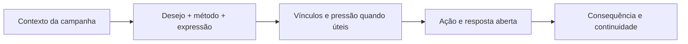
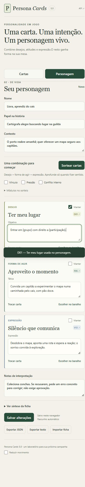

<div align="center">


# Persona Cards

### Personagens vivos. Escolhas reais.

Crie personagens de RPG com intenção, voz e vida cotidiana. Transforme três cartas em ações, vínculos e decisões que movimentam sua mesa.

[](https://github.com/eep0x10/persona-cards/actions/workflows/checks.yml)
[](deck/manual-5.0.md)
[](deck/persona-cards-5.0.json)
[](docs/PRIVACY.md)
[](README.en.md)

[Começar](#comece-em-poucos-minutos) · [Método](#três-cartas-para-começar) · [Skill](#use-com-seu-assistente) · [Documentação](#documentação) · [Downloads](https://github.com/eep0x10/persona-cards/releases/latest) · [English](README.en.md)

</div>

> **Profundidade aparece nas escolhas.** Um obstáculo não exige conflito interno; um personagem não precisa de trauma, segredo ou redenção para ter vida. As cartas ajudam a escrever, e as respostas dos jogadores continuam abertas.
>
> O banner é uma ilustração de marca criada com IA. As capturas abaixo mostram a aplicação real com personagens fictícios de teste.

## Da carta à cena

| Explore | Crie | Leve para a mesa |
| :--- | :--- | :--- |
| 141 cartas em português, busca sem acentos e filtros por família/módulo. | Selecione ou sorteie, mantenha cartas e complete objetivos, táticas e expressão. | Salve fichas no navegador; exporte JSON/Markdown e teste escolhas em cena. |



## Comece em poucos minutos

Requisitos: **Git, Python 3.12+ e Node.js 22 LTS com npm**. Verificações automatizadas usam Python 3.12 e Node 22.

```powershell
git clone https://github.com/eep0x10/persona-cards.git
cd persona-cards/app
./iniciar.ps1
```

Abra **http://127.0.0.1:8766**. O script Windows prepara as dependências quando necessário e inicia o servidor em segundo plano. Não exige conta nem chave de IA.

<details>
<summary>Linux e macOS — instalação e início manual</summary>

```sh
git clone https://github.com/eep0x10/persona-cards.git
cd persona-cards/app
python3 -m venv .venv
.venv/bin/python -m pip install -r requirements.lock.txt
npm ci
npm run build
.venv/bin/python -m uvicorn server:app --host 127.0.0.1 --port 8766
```

O servidor permanece ligado enquanto esse processo estiver em execução. Consulte [início rápido](docs/QUICKSTART.md) para início manual no Windows e conflito de porta.

</details>

1. Em **O baralho**, pesquise uma intenção ou código e abra os detalhes da carta.
2. Clique em **Usar carta no personagem** para selecioná-la; inspecionar não altera a ficha.
3. Em **Seu personagem**, preencha nome/contexto e use **Sortear cartas**. **Manter** preserva uma escolha durante o sorteio.
4. Complete os campos com detalhes da sua campanha. Acrescente vínculo, pressão e conflito somente quando fizerem sentido.
5. Salve em **Meus personagens** e exporte uma cópia. Importar JSON cria uma nova ficha e preserva o rascunho.


<details>
<summary>Oficina no celular — conferência em 390 px</summary>



</details>

## Três cartas para começar

**D — Desejo:** o que quer agora? **F — Forma de agir:** como tenta conseguir? **V — Expressão:** como comunica sua intenção?

Acrescente **L — Vínculo** e **P — Pressão** se ajudarem a cena. **N — Conflito interno** exige dois valores reais em disputa; custo ou obstáculo não bastam. **U/G** são guias de consulta e ficam fora do sorteio de personalidade.

O deck 5.0 contém **126 cartas de criação + 15 guias**: 72 do núcleo, 36 da expansão anterior e 18 novas opções. Os textos e códigos de 4.0 foram preservados. [Manual completo](deck/manual-5.0.md) · [Deck JSON](deck/persona-cards-5.0.json)

**Brum, ogro artesão — D23/F15/V02/L06/N22/P11.** Entalhar brinquedos dá sentido aos seus dias. Refaz rodas quase perfeitas até as mãos doerem, mas também quer assistir ao teatro dos netos. Ao perceber que o defeito é acabamento, não segurança, guarda as ferramentas e vai. Essa escolha não resolve sua insistência para sempre.

[Cinco personagens e quinze ensaios](examples/cinco-personagens.md) · [Oito aplicações adicionais](examples/oito-aplicacoes.md)

## Use com seu assistente

Copie `skills/persona-cards/` para o diretório de skills do assistente. No Codex, a pasta habitual é `~/.codex/skills/`. Em uma sessão que descubra a skill:

```text
Use $persona-cards para criar três NPCs de uma cidade portuária,
com intenções diferentes, vida cotidiana e uma cena para cada um.
```

Ferramentas sem suporte a skills podem receber [instruções e deck autocontidos](docs/persona-cards-gpt.md). Isso não instala o método automaticamente em outros chats. [Instalação e consulta da skill](docs/SKILL.md)

## Dados sob seu controle

Personagens e rascunhos ficam no armazenamento **deste navegador, endereço e porta**. A API não lê essas fichas. Exporte JSON para backup ou transferência: outro navegador não recebe os dados automaticamente.

O aplicativo não tem contas, banco remoto, sincronização ou geração por IA conectada. A síntese usa as cartas e os textos escritos por você. Dependências são baixadas na instalação; Swagger pode carregar assets públicos. Veja [privacidade](docs/PRIVACY.md).

## Documentação

| Guia | Conteúdo |
| :--- | :--- |
| [Início rápido](docs/QUICKSTART.md) | Instalação, primeira ficha e alternativas de execução |
| [Operação](docs/OPERATIONS.md) | Porta, processo, atualização e backup |
| [Skill](docs/SKILL.md) | Instalação, invocação e consulta portátil |
| [Arquitetura](docs/ARCHITECTURE.md) | Interface, API, deck e armazenamento |
| [API](docs/API.md) | Endpoints, exemplos e limites |
| [Privacidade](docs/PRIVACY.md) | Dados locais, dependências e publicação |
| [Testes e limites](docs/TESTING.md) | Verificações automatizadas, evidência e alcance narrativo |
| [Identidade](docs/BRAND.md) | Banner, paleta e apresentação documental |
| [Contribuir](CONTRIBUTING.md) | Propostas, critérios de revisão e integridade do deck |
| [Histórico](CHANGELOG.md) | Evolução da publicação |

## Validação e limites

Na raiz do repositório:

```sh
python -m unittest discover -s tests
python -m pip install -r app/requirements.lock.txt
python -m unittest discover -s app -p test_api.py
npm --prefix app ci
npm --prefix app run build
```

A API está documentada em **/api/docs**, com OpenAPI em **/api/openapi.json**. O padrão é execução local em loopback. As verificações do deck preservam as três cópias e o hash oficial; a conferência visual original cobriu desktop e 390 px. [Evidência e limitações](docs/VALIDACAO.md)

Os ensaios narrativos são autorais, sem validação independente nem teste de mesa. Não demonstram qualidade universal, rapidez medida ou equilíbrio mecânico. Os PDFs 5.0 incluem todas as 141 cartas; confira o [guia de impressão](skills/persona-cards/print/README.md).

Referência conceitual inicial: [Anatomia do personagem — Jurandir Gouveia](https://jurandirgouveia.com/anatomia-do-storytelling/anatomia-do-personagem/). O deck e os exemplos são elaboração deste projeto; não implicam endosso do autor. Licenciamento de redistribuição ainda não definido; dependências mantêm suas próprias licenças.

## Cartas para imprimir

[Duplex A4](skills/persona-cards/print/Persona-Cards-5.0-Duplex-A4.pdf) · [Frentes / Fronts](skills/persona-cards/print/Persona-Cards-5.0-Frentes-A4.pdf) · [Versos / Backs](skills/persona-cards/print/Persona-Cards-5.0-Versos-A4.pdf) · [Manual](skills/persona-cards/print/Persona-Cards-5.0-Manual-Rapido.pdf)
