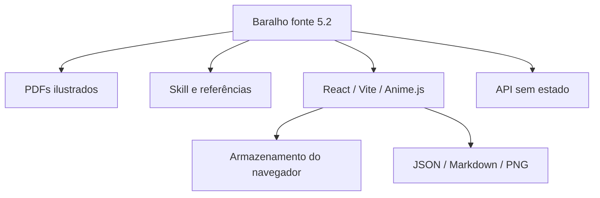

# Arquitetura — Persona Cards 5.2

[Projeto](../README.md) · [API](API.md) · [Privacidade](PRIVACY.md)

## Baralho e fontes

A identidade do produto é o jogo de cartas. O deck 5.2 tem 166 cartas: 150 de criação em OR/CV/D/F/V/L/P/N e 16 guias U/G. G07 acompanha a criação com chamado, resposta, fato, crença e escolha. Nenhuma família de criação é opcional; U/G permanecem fora do sorteio de personalidade.

As três cópias ativas são `deck/persona-cards-5.2.json`, `app/public/deck.json` e `skills/persona-cards/references/deck.json`, idênticas em bytes. `versao: 5.2` identifica o contrato; `revisao_editorial: 5.2.0`, os textos atuais. Os arquivos 5.0/5.1 e seus manuais são históricos.

`deck/build_5_2.py` produz o deck. `deck/build_5_2_docs.py` consome o JSON 5.2 e gera manual 5.2, referência da skill, índice e texto para GPT; não escreve JSON, PDFs nem manual 5.1. A geração usa campos reais, incluindo as listas e registros de G07. Arte e impressão têm manifesto próprio da edição 5.2.

## Aplicação e persistência

O frontend mantém mesa, revisão, carta final, biblioteca e galeria. A mesa usa as oito famílias sem formulário de interpretação. Salvar/revisar abre nome, oito interpretações e `journey.call/response/fact/belief/choice`; foto, papel, contexto e notas são livres. A finalização verifica todas as camadas e a jornada. Anime.js usa scopes/revert e controle de movimento reduzido.

O deck é empacotado no build; a API carrega sua cópia ao iniciar e serve `app/dist/`. Vite de desenvolvimento encaminha `/api` ao serviço local. Uma alteração de deck requer reconstruir a interface e reiniciar a API para publicar a mesma edição.

`model.js` concentra importação, validação, finalização e exportação. `portrait.js` processa raster localmente; `exportPng.js` produz a carta visual. JSON é o backup completo; PNG/Markdown são formatos de leitura.

Rascunhos ficam no navegador, na chave `persona-cards-workbench-v1`, separados por origem. `persistence.js` recupera registros válidos e exige backup exclusivo com leitura de conferência antes de substituir dados parcialmente inválidos. Falha de armazenamento mantém aviso e permite exportar o trabalho em memória.

## Compatibilidade

Fichas 5.0/5.1 preservam identidade, códigos, texto, foto e notas. A migração abre um rascunho pendente 5.2; não inventa OR/CV, valores N nem jornada. Aceitar o arquivo não significa que ele possa ser finalizado sem completar os novos campos. A API também distingue composição completa e rascunho explícito; veja o contrato em [API](API.md).

## Inspiração

Os 100 registros de `app/public/inspirations.json` são leituras históricas parciais. Não foram convertidos em 100 criações completas de oito famílias. Copiar uma base cria um rascunho independente e conserva o original, sem preencher novos antecedentes.

`entry.rationale` explica as escolhas editoriais; `character.fields` interpreta cada carta na cena. A prévia/detalhes percorrem as camadas realmente presentes no exemplo, sem fingir que OR/CV/N ausentes existem. A consulta pública desses exemplos não dá acesso a fichas pessoais.
