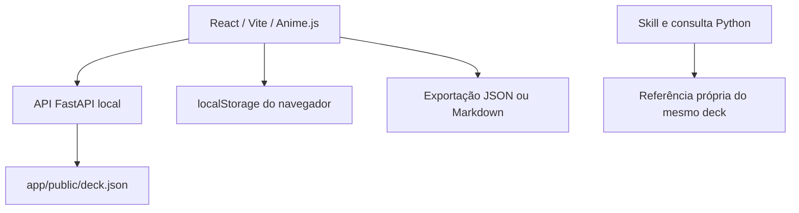

# Arquitetura

[Projeto](../README.md) · [API](API.md) · [Privacidade](PRIVACY.md)

`app/src/App.jsx` mantém a oficina, catálogo, biblioteca e validação de fichas. O frontend usa React, Vite e Anime.js; instâncias de animação são limpas por scope/revert, respeitando movimento reduzido. A API carrega o deck no início e serve o build em `app/dist/`. O Vite de desenvolvimento encaminha `/api` ao servidor local.

Rascunhos e fichas ficam em localStorage, chave `persona-cards-workbench-v1`. A API não os recebe nem consulta: composição produz prompts sem persistência. O sorteio do frontend acontece no cliente; o endpoint de sorteio oferece a mesma capacidade a consumidores da API.

O deck existe em três locais para uso independente: `deck/persona-cards-5.0.json`, `app/public/deck.json` e `skills/persona-cards/references/deck.json`. Testes verificam identidade byte a byte e hash congelado. `.gitattributes` preserva os bytes dessas cópias.

A skill reúne o fluxo narrativo, manual, índice, exemplos e consulta Python padrão. Não chama um serviço de geração de texto. Assistentes interpretam o método; a oficina continua funcional sem IA conectada.
