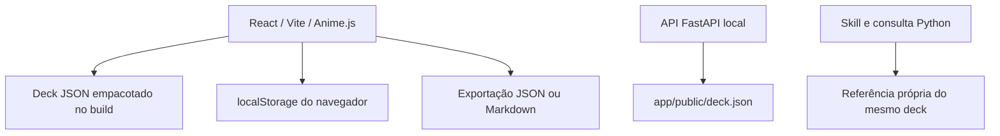

# Arquitetura

[Projeto](../README.md) · [API](API.md) · [Privacidade](PRIVACY.md)

`app/src/App.jsx` mantém a mesa de cartas e a biblioteca. A apresentação é guiada por D/F/V, com leitura, virada e seleção de cartas, sem formulário de identidade ou interpretação. O frontend usa React, Vite e Anime.js; instâncias de animação são limpas por scope/revert, respeitando movimento reduzido. O deck é importado no build, portanto as ações da interface não dependem da API. A API compatível continua carregando sua cópia do deck no início e serve o build em `app/dist/`; o Vite de desenvolvimento encaminha `/api` ao servidor local.

Rascunhos e fichas ficam em localStorage, chave `persona-cards-workbench-v1`. A API não os recebe nem consulta: composição produz prompts sem persistência. O sorteio do frontend acontece no cliente; o endpoint de sorteio oferece a mesma capacidade a consumidores da API.

`model.js` concentra validação, combinação, importação e exportação; `motion.js` mantém as animações Anime.js com scopes e cancelamento. `persistence.js` recupera fichas válidas de dados parcialmente inválidos e exige backup exclusivo, com leitura de conferência, antes de substituir o original. Ajuda e Importar/exportar permitem baixar os originais recuperados. Se o navegador bloquear o armazenamento, a mesa funciona em memória com aviso; exportar é necessário para conservar a combinação.

Dados antigos de nome, papel, contexto, interpretação e notas continuam no esquema e nas exportações mesmo sem controles de edição na mesa. As ilustrações usam o manifesto do PDF e os atlas originais em `app/public/art/`; recortes CSS preservam a proporção sem editar os PNG. O navegador carrega as imagens das cartas renderizadas, em vez de antecipar toda a coleção.

O deck ativo existe em três locais para uso independente: `deck/persona-cards-5.1.json`, `app/public/deck.json` e `skills/persona-cards/references/deck.json`. `deck/build_5_1.py` acrescenta a leitura de cada carta à fonte 5.0 congelada e gera as três cópias byte a byte idênticas. O deck e os PDFs 5.0 permanecem como histórico. `.gitattributes` preserva os bytes das cópias.

A impressão ilustrada usa [24 spritesheets](../deck/illustration_sheets_5_1.json) com 141 células atribuídas a códigos únicos. `deck/render_print_illustrated_5_1.py` compõe a arte própria de cada carta com a leitura 5.1, ajusta o espaço da imagem ao texto e gera frentes, verso comum, duplex e manual A4. O manifesto torna a correspondência entre código, arquivo e célula verificável; `deck/verify_illustrated_print_5_1.py` confere cobertura, pixels visíveis, textos e paginação.

`python deck/build_all_5_1.py` reúne os builders editoriais, o renderer final e o verificador, em processos sequenciais com falha imediata. `render_print_5_1.py` fornece somente utilitários de texto/cor/fontes; o renderer final define sua geometria explicitamente, sem substituir funções ou variáveis de outro módulo.

A skill reúne o fluxo narrativo, manual, índice, exemplos e consulta Python padrão. Não chama um serviço de geração de texto. Assistentes interpretam o método; a oficina continua funcional sem IA conectada.
